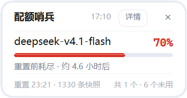
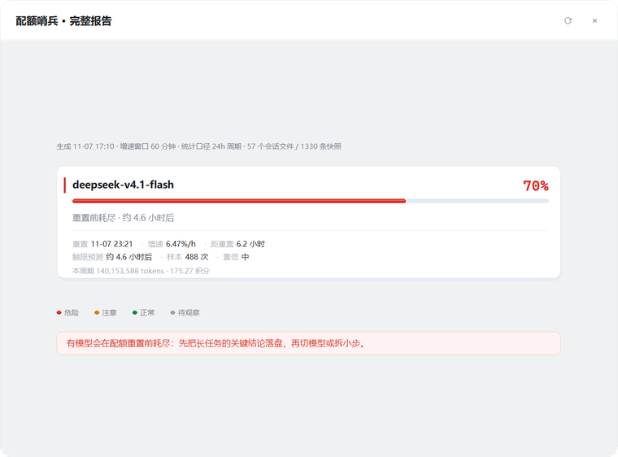

# WorkBuddy Quota Pill

[简体中文](README.md) · **English**


[](https://github.com/taohuamu/workbuddy-quota-pill/releases)

**WorkBuddy Quota Pill** (repo name **workbuddy-quota-pill**) is a small Windows desktop tool. It reads the model quota percentage WorkBuddy's server sends with each response, straight from the local session log — the raw value, no estimate — and shows each model's usage, burn rate and runway.

Quota, limit and usage refer to the same thing here: the per-model cap the server sets, and how much of it is spent. The window is usually 24 hours, counted from first use.

It's small and safe: no network access, no uploads, no account, no changes to your files, no third-party dependencies. Unzip and run — yet it shows exactly where each model stands in its current window, so you can plan your AI usage instead of being cut off mid-task.

**[Download latest](https://github.com/taohuamu/workbuddy-quota-pill/releases)** ·
[Usage guide (Chinese)](使用说明.md) ·
[Design notes](docs/design.md)

> The interface is currently Chinese-only, and the screenshots below show it as-is.

---

## Why this exists

WorkBuddy meters model usage in two separate ways: account-level credits, and a per-model quota window. Run out of credits and the whole workflow stops. Run out of one model's quota and the request dies while the model is still thinking — you wait for the reset, or switch to another model.

Meanwhile, Profile → Usage only shows your credit balance and spending history. It can't tell you what percentage of a single model's window you've used right now. So the familiar scene: DeepSeek-v4.1-Flash is generating away, WorkBuddy suddenly reports "limit reached", and the work stops halfway — along with your train of thought.

I searched GitHub and elsewhere for something that fit my needs and habits, and didn't find one. So I built this: first for myself, then for everyone else using WorkBuddy who wants to see model quotas at a glance.

## Three forms

### 1. Pill

Appears in the bottom-right corner once WorkBuddy is open. Shows the model used in the most recent conversation and how much of its window it has consumed.

<p align="center"></p>

### 2. Card

Expands on hover. Lists up to 3 models, each with a progress bar and a one-line verdict — usage and runway for each model, at a glance.

<p align="center"></p>

### 3. Full report

Opens when you click any row of the card (or "Details" at its top right). Lists every model with usage in the current window, with its reset time, burn rate and runway, plus the tokens and credits spent within that window.

<p align="center"></p>

## How it works

WorkBuddy writes session logs locally, and those logs record per-model quota usage. That is where this tool gets its data.

Log path: `%USERPROFILE%\.workbuddy\projects\<project>\<session>.jsonl`. Each line is one request, and its `providerData.rawUsage.quota` field holds the quota state for that response: `model`, `percent`, `reset_at`, `shared_models`.

Not every record carries `quota`: measured on this machine, about half of deepseek's records do, under a tenth of hy4's, and none of glm-5.3-flash's. The percentage is therefore a series of discrete samples, with no interpolation and no averaging.

`percent` and `reset_at` are reported by the server with each response and written to the log by the client. This tool reads them as-is, without processing of any kind. `percent` is an integer with 1% granularity; the interface shows it unmodified, with no interpolation.

To estimate the runway, it derives three things from that:

1. Window: `reset_at` minus 24 hours — only records inside that window count
2. Burn rate: the change in `percent` across the window, divided by elapsed time (percentage points per hour)
3. Runway: extrapolate the burn rate to 100% and estimate the time remaining

When the sample window is too short or there are too few data points, no runway is shown; the report says "only N minutes of samples, no forecast yet".

## Startup and shutdown

With 「开机自动待命」(start with Windows) enabled, a watchdog launches at boot and checks every 5 seconds whether WorkBuddy is running.

While WorkBuddy isn't running, nothing appears.

When WorkBuddy starts, the watchdog picks it up on its next check and launches this tool; the whole sequence takes about 3 seconds. While running, the tool probes state every 1.5 seconds; after more than 3 seconds in another application it hides itself, and comes back as soon as you return to WorkBuddy.

When WorkBuddy exits, the tool ends itself 10 seconds later, leaving only the watchdog waiting. The watchdog does not guard the tool: it queries the process list every 5 seconds and sleeps the rest of the time. Its only job is to launch the tool when WorkBuddy starts.

Without 「开机自动待命」, nothing is waiting — double-click `tray.bat` after each boot.

## Controls

| Action | Result |
|---|---|
| Hover the pill | Expands into the card |
| Move the mouse away | Collapses after 2.2 seconds |
| Click any row of the card | Opens the full report |
| Drag | Both axes; save the position from the right-click menu |
| Right-click | Refresh / Full report / Save layout / Reset position / toggles |

## Installation

Requirements: Windows 10 / 11 and Python 3.8+. The official Python installer bundles tkinter, so nothing extra is needed.

1. Download the archive from [Releases](https://github.com/taohuamu/workbuddy-quota-pill/releases) and unzip it anywhere (avoid spaces and non-ASCII characters in the path).
2. Double-click `tray.bat`.
3. Right-click the tool and check 「开机自动待命」(start with Windows).

## Updating

1. Right-click the tool and choose Exit.
2. Unzip the new version over the old directory.
3. Double-click `tray.bat`.

Step 1 is required. If the old instance is still running, the new one exits immediately because of the single-instance lock, and the update looks like it never took effect.

## FAQ

1. **GLM-5.3-Flash shows no usage**: its entries in the local log have no `quota` field, so there is no percentage to read. deepseek, hy4 and glm-5.3 all report one over the same period, so this is a per-model difference (and even within GLM, 5.3 and 5.3-flash differ), not a missed read.
2. **hy4's number stays put for a long time**: free models do have a 24-hour window and can run close to the limit before a reset, but under a tenth of their responses carry `quota`, so the percentage updates sparsely. When samples are too thin, the report says "no forecast yet".
3. **A model that was just reset and hasn't been used doesn't appear**: showing an empty 0% model serves no purpose.
4. **The position drifts after changing display scaling or monitors**: right-click → Recalibrate position. It collapses the card first, then measures the input box edge again, and self-checks the result.
5. **The window is not a calendar day**: it is a rolling 24 hours, not a midnight reset. Each model's end time comes from the server, counted from first use, and differs between models. The report shows it directly: "resets in 3.5 h".
6. **The pill doesn't appear**: it stays hidden while WorkBuddy isn't running. If WorkBuddy is running and it's still missing, check the last lines of `%LOCALAPPDATA%\quota-watch\tray.log`.
7. **Double-clicking `tray.bat` does nothing**: usually Python without tkinter. Run `python quota_tray.py --which` in the unzipped directory; the output should include a line starting with `tk`.
8. **The number doesn't match my credit balance**: this is one model's usage in its current window, not the account credit balance — different meters. `percent` is an integer at 1% granularity, so it can still read 0% after a while of use.
9. **Where is the data stored, and is anything uploaded?** All of it comes from local session logs. On the international build the path is `~/.workbuddy-ai/projects/...`; the `WORKBUDDY_HOME` environment variable overrides the root. The tool only reads files — it writes nothing to WorkBuddy's data and makes no network requests; everything stays on your machine.
5. **The pill doesn't appear**: it stays hidden while WorkBuddy isn't running. If WorkBuddy is running and it's still missing, check the last lines of `%LOCALAPPDATA%\quota-watch\tray.log`.
6. **Double-clicking `tray.bat` does nothing**: usually Python without tkinter. Run `python quota_tray.py --which` in the unzipped directory; the output should include a line starting with `tk`.
7. **The number doesn't match my credit balance**: this is one model's usage in its current window, not the account credit balance — different meters. `percent` is an integer at 1% granularity, so it can still read 0% after a while of use.
8. **Where is the data stored, and is anything uploaded?** All of it comes from local session logs. On the international build the path is `~/.workbuddy-ai/projects/...`; the `WORKBUDDY_HOME` environment variable overrides the root. The tool only reads files — it writes nothing to WorkBuddy's data and makes no network requests; everything stays on your machine.

## Development

```bash
python tests/test_tray.py     # presentation layer, 168 checks
python tests/test_core.py     # data layer, 56 checks
python tools/package.py       # build the beta archive into dist/
python tools/preview.py out.bmp --pill   # offscreen render for a screenshot
```

The graphical part has no automated assertions — layered windows (`-transparentcolor`) are hard to reproduce headless, so those judgements rely on images captured by `tools/preview.py`.

See [`docs/design.md`](docs/design.md) for details (Chinese).

## Disclaimer

A third-party tool, not affiliated with Tencent or WorkBuddy. It has no technical support or authorization of any kind from them, and only reads log files that already exist on your machine.

## License

[MIT](LICENSE)
