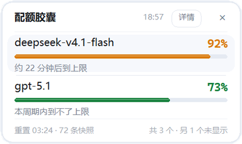
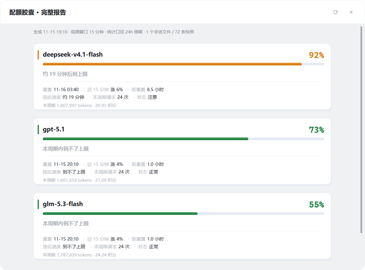

# WorkBuddy 配额胶囊

**简体中文** · [English](README.en.md)


[](https://github.com/taohuamu/workbuddy-quota-pill/releases)

**WorkBuddy 配额胶囊**（英文名 **workbuddy-quota-pill**）是一个 Windows 桌面小工具。它读取 WorkBuddy 本地会话日志中服务端随响应下发的模型配额百分比（原值，不做估算），显示各模型本周期的用量、最近 15 分钟的消耗，以及按这个速度到上限还要多久。

它小巧安全，不联网，不上传，不碰账号，不改文件，无第三方依赖，解压即用，却能准确显示各模型本周期的额度用量，辅助你安排 AI 使用，避免因突发限额打断思路。

注意，在本工具中，额度、限额、用量指的是同一件事：服务端为每个模型划定的周期上限，以及已经用掉的百分比。周期通常为 24 小时，从首次使用起算。

**[下载最新版](https://github.com/taohuamu/workbuddy-quota-pill/releases)** ·
[使用说明](使用说明.md) ·
[设计档案](docs/design.md)

---

## 开发缘起

WorkBuddy 对模型用量有两套限制：一个是账号级的积分，一个是每个模型各自的周期配额。
如果是积分耗尽，整个工作流都会停下来；如果是某个模型的配额耗尽，则会在模型思考时中断，等配额重置或切到别的模型后才能继续。

可是，WorkBuddy 的「个人中心 → 用量」只能看到积分余额和消耗明细，看不到单个模型此刻的额度用掉了百分之多少。于是，一个常见的情景出现了：正当我们的 DeepSeek-v4.1-Flash 充满激情地
生成内容时，WorkBuddy 突然提示「已达上限」，导致我们工作和思路都被打断。

为解决这个问题，我在 GitHub 等网站多次搜寻相关内容，但并没有找到符合我需求和习惯的工具。
于是我做了这个小工具，来帮助我和其他使用 WorkBuddy 的人直观地看到模型使用配额。

## 三种形态

### 1. 胶囊

WorkBuddy 打开后出现在右下角。显示最近一次对话用的模型以及这个模型在本周期的额度使用百分比。

<p align="center"></p>

### 2. 小卡片

鼠标触碰胶囊后展开。最多列 3 个模型，每个模型配一条进度条和一句判决语，直观呈现各模型的额度使用情况与预计耗尽时间。

<p align="center"></p>

### 3. 完整报告窗

点卡片上任意一行（或右上角「详情」）打开。列出当前周期内有消耗的模型，包含各自的重置时间、近 15 分钟的增量、按此速度的预计时间，以及周期内的 token 与积分消耗。

<p align="center"></p>

窗口不是唯一的选择。同一份数据和判据还做成了[技能版](https://github.com/taohuamu/workbuddy-quota-pill-skills)：装进 WorkBuddy 里，之后会上架 WorkBuddy 技能市场，敬请期待。

## 颜色含义

颜色只有一个来源：这个模型当前的**判定等级**。等级由「已用百分比」和一个「按最近 15 分钟的速度会不会撑不到重置」的判定取更重的一档。

| 颜色 | 等级 | 什么时候出现 |
|---|---|---|
| 红 | 危险 | 已用 **≥ 95%** |
| 琥珀 | 注意 | 已用 **≥ 80%**；或按当前速度撑不到本周期重置（且窗口内至少涨了 4 个百分点） |
| 绿 | 正常 | 其余情况 |
| 灰 | 待观察 | 没有可判的数据：还没有快照，或全部停在上一周期 |

三点容易误会的：

- **胶囊左侧的灯取全场最危险的那一档，右侧数字取它自己那个模型的档位**，所以会出现「红灯配绿色数字」——意思是「有个别的模型快撞墙了，当前这条还健康」。
- **「撑不到重置」不是固定几小时**。工具算的是「按现在这速度，多久走到 100%」，再和各模型自己的重置时刻比先后：先到就是撑不到。距重置还剩 3 小时、预计 4 小时后到上限，反而算安全——反正到那时配额已经刷新了。
- **`--pct` / `--warn` 改不动颜色**。它们是可选的通知提醒参数（默认已用 80% 或 2 小时内触限时弹窗），只决定要不要打扰你。

## 工作原理

WorkBuddy 在本地写有会话日志，其中记录了各模型的周期配额使用情况。本工具的数据来源于此。

日志路径为 `%USERPROFILE%\.workbuddy\projects\<项目>\<会话>.jsonl`。每行对应一轮请求，其中 `providerData.rawUsage.quota` 字段记录该轮响应的配额状态，包含 `model`、`percent`、`reset_at`、`shared_models` 四个键。

并非每条记录都带 `quota`：实测 deepseek 约三分之二带、hy4 约一成带、glm-5.3-flash 一条都没有。因此百分比是一串离散样本点，本工具不补间、不平均。

`percent` 与 `reset_at` 由服务端随响应下发，客户端写入日志，本工具直接读取，不做任何加工。`percent` 为整数，粒度 1%，界面按原值显示，不做插值。

为预测触限时间，本工具在此基础上计算三项：

1. 周期窗口：`reset_at` 减 24 小时，仅统计该区间内的记录
2. 观测：数**最近 15 分钟涨了几个百分点**（相邻快照的正增量累加，回退记 0）
3. 触限预测：用这个涨幅估等待时间的分位——中位数给「约 X 分钟后到上限」，样本足够时附区间

为什么不用「首尾相减」：整数百分比下 15 分钟涨 1 个百分点就是 4 个百分点/小时，端点差分的量化误差是 100%；
而 15 分钟窗口里的几十条快照只用上两条，服务端的 ±1 回退还会被算成负贡献。

最近 15 分钟没涨过就不给时间，只写「近 15 分钟无新增」——那是观测事实，
「没有消耗」才是猜测，界面只报前者。

## 启停机制

若启用「开机自动待命」，开机时启动看门狗，每 5 秒检查一次 WorkBuddy 是否在运行。

WorkBuddy 没启动的时候，它不出现。

WorkBuddy 启动后，看门狗在下一次检查时发现并启动本工具，整个流程约 3 秒。运行期间，本工具每 1.5 秒探测一次状态；切到其他应用超过 3 秒，它自动隐藏，回到 WorkBuddy 后随即恢复。

WorkBuddy 退出后，本工具在 10 秒后自行结束进程，只剩看门狗继续等待。看门狗不守护本工具，每 5 秒查询一次进程表，其余时间处于休眠，职责只有一条：WorkBuddy 启动时把本工具拉起来。

未启用「开机自动待命」时，每次开机需要手动双击 `tray.bat`。

## 操作说明

| 操作 | 效果 |
|---|---|
| 鼠标触碰胶囊 | 展开卡片 |
| 移开鼠标 | 2.2 秒后自动收回 |
| 点击卡片任意一行 | 打开完整报告窗 |
| 拖动 | 横向纵向均可，位置需在右键菜单保存 |
| 右键 | 刷新 / 完整报告 / 保存布局 / 恢复默认位置 / 各项开关 |

## 安装流程

前置要求：Windows 10 / 11，Python 3.8 以上。Python 官网安装包默认带 tkinter，不需要额外安装。

1. 从 [Releases](https://github.com/taohuamu/workbuddy-quota-pill/releases) 下载压缩包，解压到任意目录（路径建议不含空格和中文）。
2. 双击 `tray.bat`。
3. 右键小窗，勾选「开机自动待命」。

## 更新流程

1. 右键小窗，选择「退出」。
2. 解压新版本，覆盖原目录。
3. 双击 `tray.bat`。

注意：第 1 步不能省。旧实例还在运行时，新实例会因单实例限制直接退出，看起来像更新未生效。

## 常见疑问

1. **GLM-5.3-Flash 不显示用量**：本地日志中该模型没有 `quota` 字段，取不到百分比。同一时段
   deepseek、hy4 与 glm-5.3 都能取到，这是模型侧的差异，不是漏读。
2. **hy4 的数字长时间不动**：免费模型同样有 24 小时配额，会接近上限再重置，但只有
   约一成的响应带 `quota` 字段，百分比因此更新稀疏。久未更新时卡片写「近 15 分钟无新增」，报告里对应两列是 `涨 0%` 与 `—`；这是观测事实，不是「不会用完」。
   报告中的 `hy4` 是配额池名称，对应模型列表里的 `hy4-free`。
3. **刚重置、未使用的模型不显示**：显示一个 0% 的空模型没有意义。
4. **换过缩放比例或显示器后位置可能偏**：右键「重新校准位置」。它会把卡片先收起来，
   再量一次输入框边缘，量完还会自检。
5. **「周期」不是自然日**：周期为 24 小时滚动窗口，不是每天 0 点重置。各模型的结束时刻由
   服务端下发，从首次使用起算，互不相同。报告窗直接显示「3.5 小时后重置」。
6. **胶囊不出现**：WorkBuddy 未运行时它不显示。若 WorkBuddy 正在运行仍无显示，查看
   `%LOCALAPPDATA%\quota-pill\tray.log` 末尾几行。
7. **双击 `tray.bat` 没有反应**：多为 Python 缺少 tkinter。在解压目录运行
   `python quota_tray.py --which`，每行形如 `11-20 23:45:43 tk  C:\...\python.exe`
   （时间、状态、路径）——**中间那段为 `tk`** 就说明该解释器带 tkinter，全是 `--` 才是缺。
8. **数字和账号余额对不上**：这里显示的是单个模型在本周期用掉的额度，不是账号积分余额，
   两者口径不同。`percent` 为整数，粒度 1%，因此会出现「用了一会儿仍显示 0%」的情况。
9. **数据存放在哪、会不会上传**：全部来自本机的会话日志。国际版路径为
   `~/.workbuddy-ai/projects/...`，可用环境变量 `WORKBUDDY_HOME` 覆盖根目录。本工具只读文件，
   不写 WorkBuddy 的任何数据，也没有任何网络请求；所有数据都留在你自己的机器上。

## 开发

```bash
python tests/test_tray.py     # 展示层纯逻辑
python tests/test_core.py     # 数据层
python tools/package.py       # 打内测包到 dist/
python tools/preview.py out.bmp --pill   # 离屏渲染一张图
```

图形部分没有自动断言 —— 分层窗口（`-transparentcolor`）的行为很难在无头环境复现，
相关判断靠人工看 `tools/preview.py` 抓出来的图。

详情请见 [`docs/design.md`](docs/design.md)。

## 声明

第三方工具，与腾讯 / WorkBuddy 官方无关。本项目只读取本机已经存在的日志文件，未获得任何形式的技术支持。

## License

[MIT](LICENSE)
