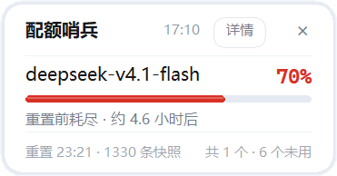
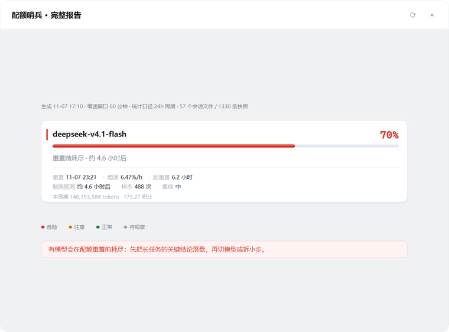

# WorkBuddy 配额小窗


[](https://github.com/taohuamu/workbuddy-quota-pill/releases)

WorkBuddy 配额小窗是一个显示 WorkBuddy 各模型周期（通常为 24 小时）额度使用情况的特化小工具。
它能读取服务端随每轮响应下发的额度使用百分比（原始值）并直接呈现给我们，同时提供大概多久
用完周期配额的预测。

它小巧安全，不联网，不上传，不碰账号，不改文件，无第三方依赖，解压即用。但它能准确显示
各模型本周期的额度用量，辅助你安排 AI 使用，避免因突发限额打断思路。

**[下载最新版](https://github.com/taohuamu/workbuddy-quota-pill/releases)** ·
[使用说明](使用说明.md) ·
[设计档案](docs/design.md)

---

## 开发缘起

WorkBuddy 对模型用量有两套限制：一个是账号级的积分，一个是每个模型各自的周期配额。
如果是积分耗尽，整个工作流都会停下来；如果是某个模型的配额耗尽，则会在模型思考时中断，
等配额重置或切到别的模型后才能继续。

可是，WorkBuddy 的「个人中心 → 用量」只能看到积分余额和消耗明细，看不到单个模型此刻的
额度用掉了百分之多少。于是，一个常见的情景出现了：正当我们的 DeepSeek-v4.1-Flash 充满激情地
生成内容时，WorkBuddy 突然提示「已达上限」，导致我们工作和思路都被打断。

为解决这个问题，我在 GitHub 等网站多次搜寻相关内容，但并没有找到符合我需求和习惯的工具。
于是我做了这个小工具，来帮助我和其他使用 WorkBuddy 的人直观地看到模型使用配额。

## 三种形态

### ① 胶囊

WorkBuddy 打开后出现在右下角。显示最近一次对话用的模型以及这个模型在本周期的额度使用百分比。

<p align="center"></p>

### ② 小卡片

鼠标触碰胶囊后展开。最多列 3 个模型，每个模型配一条进度条和一句判决语，
直观呈现各模型的额度使用情况与预计耗尽时间。判决语如「10.9 小时内触限」，
意思是照当前速度，再过 10.9 小时额度就会用尽。

<p align="center"></p>

### ③ 完整报告窗

点卡片上任意一行（或右上角「详情」）打开。列出当前周期内有消耗的模型，包含各自的重置时间、
增速、触限预测，以及周期内的 token 与积分消耗。

<p align="center"></p>

## 启停机制

若启用「开机自动待命」，开机时启动看门狗。它常驻内存约 5MB，单核 CPU 占用约 0.2%
（8 核整机约 0.03%），每 5 秒检查一次 WorkBuddy 是否在运行。

WorkBuddy 没启动的时候，它不出现。

WorkBuddy 启动后，看门狗在下一次检查时发现并启动本工具，整个流程约 3 秒。运行期间，
本工具每 1.5 秒探测一次状态；切到其他应用超过 3 秒，它自动隐藏，回到 WorkBuddy 后随即恢复。

WorkBuddy 退出后，本工具在 10 秒后自行结束进程，只剩看门狗继续等待。

看门狗**不守护本工具**，只做一件事：发现 WorkBuddy 起来了，就把它启动起来 —— 所以既不会
开机就白占一份 Python 进程，也不会错过启动时机。

未启用「开机自动待命」时，每次开机需要手动双击 `tray.bat`。

## 工作原理

WorkBuddy 在本地写有会话日志，其中记录了各模型的周期配额使用情况。本工具的数据来源于此。

日志路径为 `%USERPROFILE%\.workbuddy\projects\<项目>\<会话>.jsonl`。每行对应一轮请求，其中
`providerData.rawUsage.quota` 字段记录该轮响应的配额状态，包含 `model`、`percent`、`reset_at`、
`shared_models` 四个键。

`percent` 与 `reset_at` 由服务端随响应下发，客户端写入日志，本工具直接读取，不做任何加工。
`percent` 为整数，粒度 1%，界面按原值显示，不做插值。

为预测触限时间，本工具在此基础上计算三项：

1. 周期窗口：`reset_at` 减 24 小时，仅统计该区间内的记录
2. 增速：区间内首尾 `percent` 之差除以时长
3. 触限预测：按当前增速外推至 100%，估算剩余时间

样本区间过短或数据点不足时不做预测，报告窗会标注「样本仅 N 分钟，暂不预测」。

## 它不做什么

反向清单比功能列表更能说明边界：

- **不联网** —— 源码里没有一行 socket / urllib / requests，跑起来不会发出任何请求
- **不碰账号** —— 不读 Cookie、不读 token、不需要登录，WorkBuddy 的凭据它看不到
- **不改文件** —— 对 WorkBuddy 的数据目录只读；写操作只有它自己的 `tray.json` 和 `tray.log`
- **不上传** —— 没有遥测、没有统计、没有崩溃上报
- **不替你换模型** —— 只告诉你情况，怎么选是你的事
- **不算积分余额** —— 那是账号级数据，要调云端接口，本工具不碰
- **不做历史统计** —— 没有趋势图、没有月度汇总、没有「哪个项目最耗 token」。
  它只回答「此刻用了多少、还能撑几小时」

## 界面上那些话怎么读

每句判决语都对应一种确定的情况，没有模糊表述：

| 你看到的 | 含义 | 该怎么办 |
|---|---|---|
| `按当前节奏够用` | 按最近增速外推，重置前到不了 100% | 继续写 |
| `10.9 小时内触限` | 按当前增速，会在重置前打满 | 考虑换模型或收尾 |
| `重置前就会耗尽` | 增速很陡，剩下的时间不够 | 尽快收手 |
| `已到上限，随时会被拒` | 服务端已报 100% | 换模型 |
| `近期无新增消耗` | 有记录，但这一小段时间没涨 | 忽略这条 |
| `样本仅 8 分钟，暂不预测` | 数据点太少，不硬给结论 | 再等一会儿 |
| `与 3 个模型共用` | 这几个模型共享一份额度 | 只看单个会偏乐观 |

四档配色：**危险**（红）/ **注意**（黄）/ **正常**（绿）/ **待观察**（灰）。

「待观察」不是故障，是还没积累到能判断的数据 —— 它宁可空着，也不编一个数字出来。
这个取舍贯穿整个项目：`percent` 读不到就不显示，增速算不出就不预测。

## 安装流程

前置要求：Windows 10 / 11，Python 3.8 以上。Python 官网安装包默认带 tkinter，不需要额外安装。

1. 从 [Releases](https://github.com/taohuamu/workbuddy-quota-pill/releases) 下载压缩包，
   解压到任意目录（路径建议不含空格和中文）。
2. 双击 `tray.bat`。
3. 右键小窗，勾选「开机自动待命」。

## 操作说明

| 操作 | 效果 |
|---|---|
| 鼠标触碰胶囊 | 展开卡片 |
| 移开鼠标 | 2.2 秒后自动收回 |
| 点击卡片任意一行 | 打开完整报告窗 |
| 拖动 | 横向纵向均可，位置需在右键菜单保存 |
| 右键 | 刷新 / 完整报告 / 保存布局 / 恢复默认位置 / 各项开关 |

## 更新流程

1. 右键小窗，选择「退出」。
2. 解压新版本，覆盖原目录。
3. 双击 `tray.bat`。

注意：第 1 步不能省。旧实例还在运行时，新实例会因单实例限制直接退出，看起来像更新未生效。

## 常见问题

1. **GLM-5.3-Flash 等部分模型不显示用量**：本地日志中没有 `quota` 字段，取不到百分比，
   结合使用经验猜测是没有周期限额。
2. **刚重置、未使用的模型不显示**：显示一个 0% 的空模型没有意义。
3. **换过缩放比例或显示器后位置可能偏**：右键「重新校准位置」。它会把卡片先收起来，
   再量一次输入框边缘，量完还会自检。
4. **「周期」不是自然日**：周期为 24 小时滚动窗口，不是每天 0 点重置。各模型的结束时刻由
   服务端下发，从首次使用起算，互不相同。报告窗直接显示「3.5 小时后重置」。
5. **胶囊不出现**：WorkBuddy 未运行时它不显示。若 WorkBuddy 正在运行仍无显示，查看
   `%LOCALAPPDATA%\quota-watch\tray.log` 末尾几行。
6. **双击 `tray.bat` 没有反应**：多为 Python 缺少 tkinter。在解压目录运行
   `python quota_tray.py --which`，输出中应含以 `tk` 开头的一行。
7. **数字和账号余额对不上**：这里显示的是单个模型在本周期用掉的额度，不是账号积分余额，
   两者口径不同。`percent` 为整数，粒度 1%，因此会出现「用了一会儿仍显示 0%」的情况。

## 数据来源

```
%USERPROFILE%\.workbuddy\projects\<project-key>\<session-id>.jsonl
```

国际版路径是 `~/.workbuddy-ai/projects/...`，可用环境变量 `WORKBUDDY_HOME` 覆盖根目录。

这个工具只读文件，不写 WorkBuddy 的任何数据，也没有任何网络请求 ——
所有数据都留在你自己的机器上。

## 开发

```bash
python tests/test_tray.py     # 展示层纯逻辑，160 项
python tests/test_core.py     # 数据层，56 项
python tools/package.py       # 打内测包到 dist/
python tools/preview.py out.bmp --pill   # 离屏渲染一张图
```

图形部分没有自动断言 —— 分层窗口（`-transparentcolor`）的行为很难在无头环境复现，
相关判断靠人工看 `tools/preview.py` 抓出来的图。

设计取舍、踩过的坑、坐标系约定都在 [`docs/design.md`](docs/design.md)。

## 声明

第三方工具，与腾讯 / WorkBuddy 官方无关。本项目未获得任何形式的技术支持或授权，
只读取本机已经存在的日志文件。

## License

[MIT](LICENSE)
